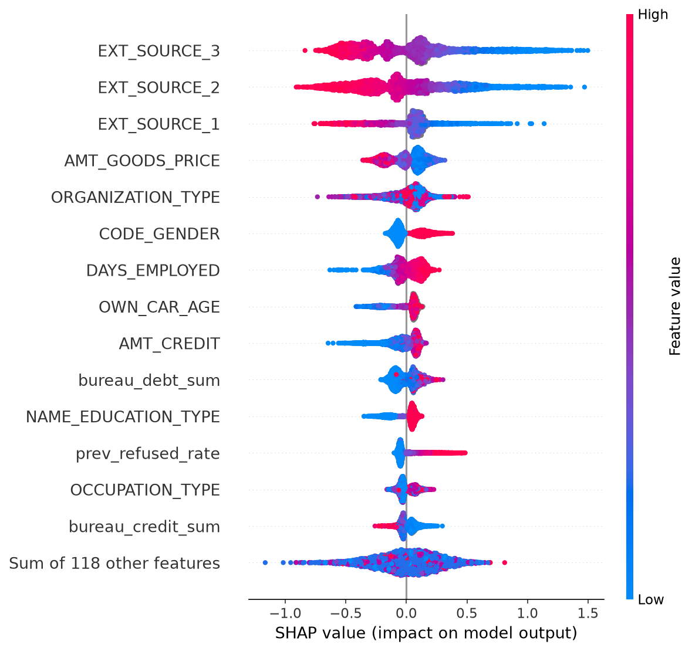
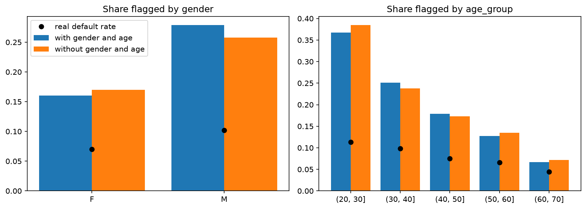
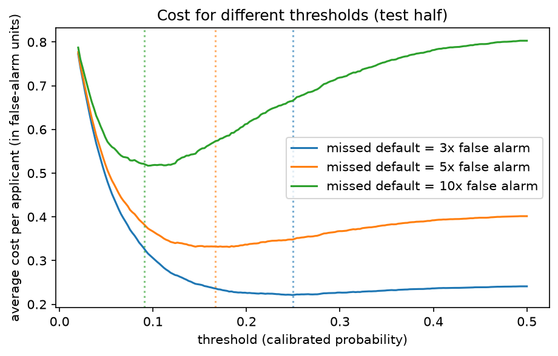

# RiskLens: Explainable Credit Risk

A credit default model that predicts whether a loan applicant is likely to default, and explains each prediction.

## Goal
Compare a transparent logistic regression scorecard with a gradient boosting model, then use SHAP to explain which factors drive risk.

## Data
Home Credit Default Risk (Kaggle). The data is not stored in this repo.
1. Join the competition on Kaggle and accept the rules.
2. Download the files and extract them into `data/raw/`.

## Project structure
- `notebooks/`: exploration and modeling
- `src/`: reusable code
- `data/`: local only, gitignored

## Status
## Status
Baseline, LightGBM, SHAP, calibration, fairness check and threshold done. Next: API, Docker, drift monitoring.

## Results

Validation set: 20% of the applicants (61,503 rows), stratified split, `random_state=42`. Threshold 0.5 for recall and precision.

| Model | ROC AUC | PR AUC | Recall | Precision |
|---|---|---|---|---|
| Logistic regression (baseline) | 0.744 | 0.224 | 0.670 | 0.159 |
| LightGBM | 0.763 | 0.258 | 0.674 | 0.174 |

### Calibration

I trained with balanced class weights, so the raw scores were too high (average 0.40 against a real default rate of 0.08). I calibrated them with Platt scaling, fitted on half of the validation set and tested on the other half.

| Scores | Mean predicted | Brier | Log loss | ROC AUC |
|---|---|---|---|---|
| Raw | 0.399 | 0.186 | 0.552 | 0.766 |
| Platt-calibrated | 0.080 | 0.067 | 0.244 | 0.766 |

The real default rate is 0.081, and always predicting 8% gives a Brier score of 0.074.

After calibration, the real default rate goes from **1.3%** in the safest 10% of applicants to **28.6%** in the riskiest 10%, and the predicted probabilities match these rates closely. The riskiest 10% contain 35% of all defaults and the riskiest 20% contain 55%. Even so, about 7 in 10 applicants in the riskiest group repay, so the model sorts applicants by risk but can't say who will default.

**Notes**
- 8.1% of the loans are defaults, so I didn't use accuracy. A random model would get a PR AUC of about 0.081.
- LightGBM improves on the baseline, but only modestly. At the same recall it makes about 1,600 fewer false alarms. I used mostly default settings and didn't tune hyperparameters.
- Most important features: the three `EXT_SOURCE` scores, then organization type, days employed and credit amount. Three features I built from the bureau and previous application tables are in the top 15.
- At a 0.5 threshold the model flags about 31% of applicants and only 17% of those flagged really default, so it's not ready for real decisions.
- `CODE_GENDER` is among the model's most used features, so fairness checks are the next step.

## Explaining the model (SHAP)

I used SHAP on the LightGBM model to see why it gives a high or low risk score. The plots use a random sample of 5,000 validation applicants.

**What I found**
- The three external scores (`EXT_SOURCE_1/2/3`) matter far more than anything else. Low scores push the risk up strongly, and the effect of `EXT_SOURCE_3` is almost a straight line.
- A short time in the current job and a high share of refused previous applications also push the risk up.
- Three features I built from the bureau and previous application tables are in the top 15.
- Gender is the 6th most important feature for the model, and age is in the model twice (`DAYS_BIRTH` and `AGE`), so checking fairness is my next step.

Two single applicants (the highest and lowest risk in the sample):

The dependence plots for `EXT_SOURCE_3` and `DAYS_EMPLOYED` are in `reports/figures/`.

## Fairness check (gender and age)

SHAP showed that gender is one of the model's most used features and that age is in the model twice, so I checked how the model treats different groups. I flagged the riskiest 20% of applicants (a cutoff of 12.6% calibrated default probability) and compared the groups on the test half of the validation set (30,752 applicants).

| Group | Real default rate | Flagged | False positive rate |
|---|---|---|---|
| Women | 7.0% | 16.0% | 13.5% |
| Men | 10.2% | 27.9% | 24.0% |
| Age 20-30 | 11.3% | 36.7% | 32.9% |
| Age 60-70 | 4.4% | 6.7% | 5.8% |

(False positive rate: share of the people who would have repaid who get flagged anyway.)

**What I found**
- The groups really differ in the data, and the model's probabilities are accurate inside each group. But flagging the top 20% makes the gaps bigger than the differences in default rate.
- A young applicant who would repay is about 5-6 times more likely to be flagged by mistake than an older one.
- Removing gender and age from the model costs almost nothing (ROC AUC 0.7657 → 0.7647, Brier 0.0671 → 0.0673) and narrows the gender gap by about a quarter to a third, but it doesn't change the age gap.
- The remaining columns can still predict gender with an AUC of 0.899, so the model isn't blind to it.

**Decision:** the final model doesn't use gender and age (`CODE_GENDER`, `DAYS_BIRTH`, `AGE`). I don't claim that it's fair, only that it doesn't use these attributes directly.

## Final model and threshold

The final model is LightGBM without gender and age, calibrated with Platt scaling (ROC AUC 0.7647 and Brier score 0.0673 on the test half of the validation set, 30,752 applicants).

To turn the probabilities into a decision, I assumed that a missed default costs 5 times as much as a false alarm. With calibrated probabilities, the best rule is then to flag applicants above 1 / (1 + 5) = **16.7%**. The 5 is my assumption, since I don't know the real costs.

| Threshold | Flagged | Recall | Precision | False positive rate |
|---|---|---|---|---|
| 16.7% | 12.4% | 40.5% | 26.3% | 10.0% |

The lowest point of each cost curve sits where the formula says it should, which is a good sign for the calibration. Compared with flagging nobody, the model lowers the average cost by 17.8%, so it helps, but only moderately.

More details are in [MODEL_CARD.md](MODEL_CARD.md).

## Limitations

-**Calibration only holds for this dataset.** I calibrated the scores with Platt scaling on half of the validation set. The probabilities match the real default rate here, but if the applicants or the default rate changed, I'd have to calibrate again.
- Recall and precision in the results table use a 0.5 threshold on the *raw* scores, before calibration. I'll choose a threshold on the calibrated probabilities later.
- The SHAP plots are on the raw (uncalibrated) scale. The Platt calibration is a straight line on the log-odds (slope 1.05), so the directions and rankings of the features are the same and the effects are only about 5% larger on the calibrated scale.
- SHAP shows what the model uses, not what causes default.
- No hyperparameter tuning, and a single random split (there is no date column in the data).
- Only 5,000 rows are used for the SHAP plots.
- The final model doesn't use gender and age directly, but other columns still carry that information, and the fairness check shows large differences in who gets flagged, especially by age. It used one random split, one threshold that I chose myself, and only gender and age. It's not a legal assessment.